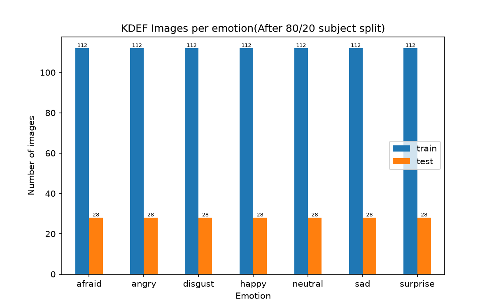
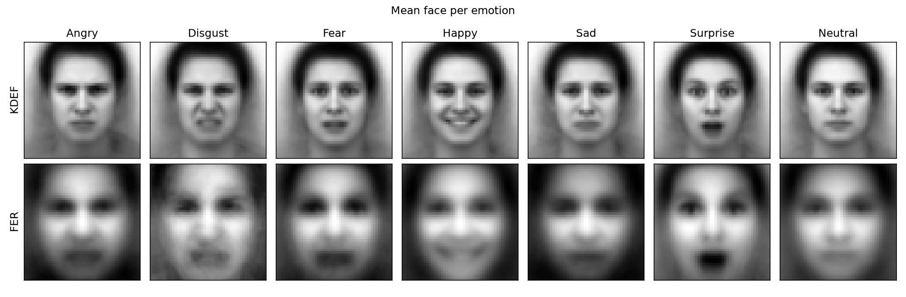
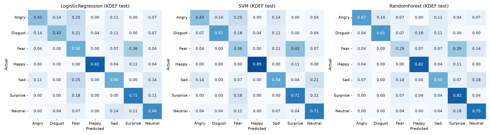

# KDEF Dataset study

In the previous task, the best feature representation for the FER dataset was HOG, with the SVM as the best model. In this task we use the same HOG features on the KDEF dataset, train three models (Logistic Regression, SVM and Random Forest) and compare their performance.

**Data and subject split**: The assignment requires the dataset to be split by subject, i.e. the training set contains the images of 80% of the subjects (56) and the test set contains the remaining 20% (14), so that no person appears in both sets. We use the provided split (`auxFiles/kdef_subject_split.pkl`, created with random seed 42). The assignment also requires us to use only the frontal (straight) images, to stay consistent with FER. This gives 784 training images and 196 test images. Every KDEF image is converted to the FER format: the face is detected, the face box is enlarged by 20%, and the crop is converted to grayscale, resized to 48x48 pixels and scaled to [0, 1]. We then extract HOG features with the same parameters as in Task 1 (9 orientations, 8x8 cells, 2x2 blocks, 900 features).

The diagram below shows the class distribution after the 80/20 split. The dataset is balanced: every emotion has 112 training and 28 test images.

## Model selection

To avoid leaking information from the test set, all model selection is done on the 56 training subjects only. For each classifier we run a grid search with 5-fold cross-validation, where the folds are split by subject (`GroupKFold`), so the images of a person are never in both the training and the validation fold. The best configuration is chosen by macro-F1. The grids cover:

- **Logistic Regression**: scaler (none, Standard, Robust, MinMax, PowerTransformer) and C in {0.01, 0.1, 1, 10}.
- **SVM**: scaler (Standard, Robust, PowerTransformer), linear, RBF and polynomial kernels, C in {0.01, 0.1, 1, 10}, gamma in {0.01, 0.001, 0.0001, auto} for RBF and degree in {2, 3, 4} for the polynomial kernel.
- **Random Forest**: number of trees {100, 200}, maximum depth {3, 5, 8, 10, 15, 20, none} and minimum samples per leaf {1, 2, 5, 10, 20, 50}.

The selected configurations are Logistic Regression with a PowerTransformer and C = 0.01, an RBF SVM with a PowerTransformer, C = 10 and gamma = 0.0001, and a Random Forest with maximum depth 10. Each selected model is then retrained on all training subjects and evaluated once on the 14 test subjects.

## Results on held-out subjects

| Classifier | CV accuracy | CV balanced acc. | CV macro-F1 | Test accuracy | Test balanced acc. | Test macro-F1 |
|---|---|---|---|---|---|---|
| Logistic Regression | 0.674 | 0.674 | 0.669 | 0.577 | 0.577 | 0.581 |
| SVM | 0.686 | 0.686 | **0.679** | 0.602 | 0.602 | 0.604 |
| Random Forest | 0.628 | 0.628 | 0.611 | **0.622** | **0.622** | **0.614** |

Because KDEF is balanced, accuracy and balanced accuracy are identical. All three models score higher on KDEF than on FER (FER validation macro-F1 0.40 to 0.51, FER test macro-F1 0.568 for the SVM), even though they are trained on only 784 images instead of about 28,700. The gap is largest for Logistic Regression and Random Forest; for the SVM, the test scores are close (0.604 on KDEF vs 0.568 on FER). The drop from cross-validation (0.679) to the test subjects (0.604) for the SVM shows that results on only 14 test subjects vary considerably.

The ranking of the models changes. On FER the order was SVM > Random Forest > Logistic Regression (validation macro-F1 0.505, 0.440 and 0.396). On KDEF cross-validation the SVM is still best, but Logistic Regression moves up to second place (0.669) and Random Forest drops to last (0.611). On the test subjects the Random Forest scores highest, but the three models are within 3.3 points of each other on only 196 test images (28 per emotion), so this difference is not reliable. We therefore keep the SVM, selected by cross-validation, as the best KDEF model.

## KDEF vs FER2013

KDEF is a controlled dataset: all photos were taken in the same studio, with the same lighting, a fixed frontal pose and actors who were asked to show each emotion clearly. FER2013 consists of in-the-wild web images with varied lighting, head poses, occlusions (hands, glasses), ages and image quality, and often subtle, spontaneous expressions with noisy labels.

The mean face per emotion shows this difference. The KDEF mean faces are sharp, because all faces are aligned in the same way, and each expression is clearly visible (for example the smile for Happy, the open mouth for Surprise and the wrinkled nose for Disgust). The FER mean faces are much blurrier, because the faces appear at different positions, scales and poses, and only the strongest expressions (the smile for Happy and the open mouth for Surprise) remain recognisable after averaging. The KDEF faces also sit smaller in the frame, with hair and background visible, because of the 20% margin around the detected face.

This explains why the same features and classifiers reach a much higher score on KDEF: the variation between images of the same emotion is small, so the expression itself is the main difference between images.

## Per-emotion performance

| Emotion | LR F1 | SVM F1 | RF F1 |
|---|---|---|---|
| Happy | 0.885 | 0.926 | 0.767 |
| Neutral | 0.610 | 0.656 | 0.689 |
| Disgust | 0.533 | 0.653 | 0.694 |
| Surprise | 0.625 | 0.615 | 0.630 |
| Sad | 0.509 | 0.545 | 0.528 |
| Angry | 0.500 | 0.500 | 0.653 |
| Fear | 0.406 | 0.333 | 0.340 |

**Happy** is the easiest emotion for all three models (F1 up to 0.926 for the SVM): the smile creates strong, consistent edges around the mouth that HOG captures well. **Fear** is the hardest for all three models (F1 0.33 to 0.41). The confusion matrices (Appendix A) show why: Fear is most often predicted as **Surprise** (43% of the Fear images for the SVM, 39% for the Random Forest), because both expressions have widened eyes, raised eyebrows and an open mouth. Other common confusions are Angry predicted as Fear or Disgust, Sad predicted as Neutral (21% for the SVM), and Disgust predicted as Fear.

Based on these results, we expect the emotions with large and distinctive facial shapes, Happy and Surprise, to transfer best to FER, and the subtle or easily confused emotions (Fear, Sad, Angry) to transfer worst. Task 3 tests this.
